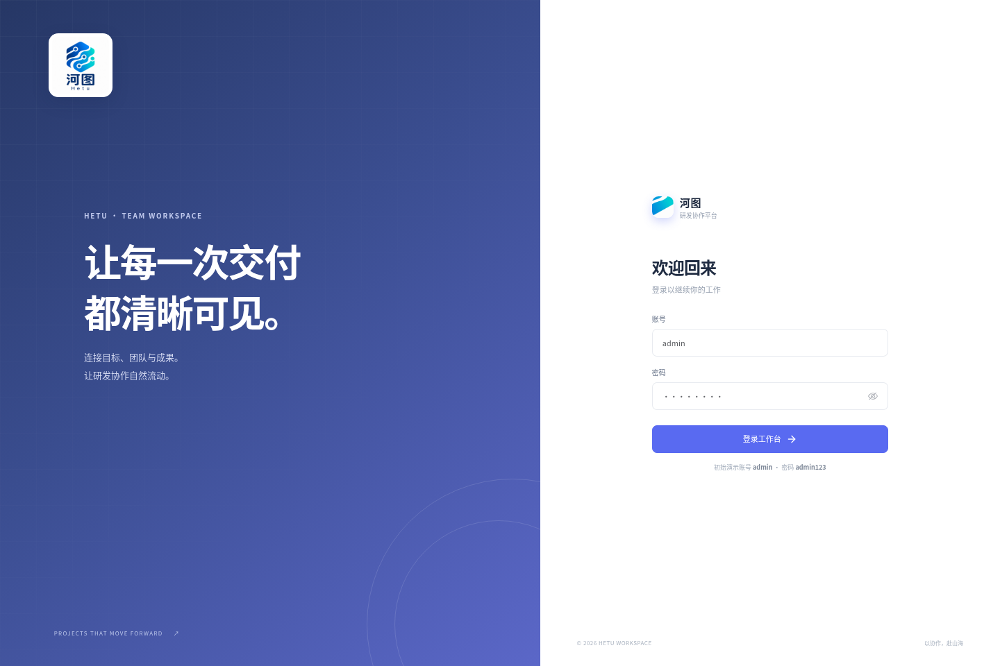
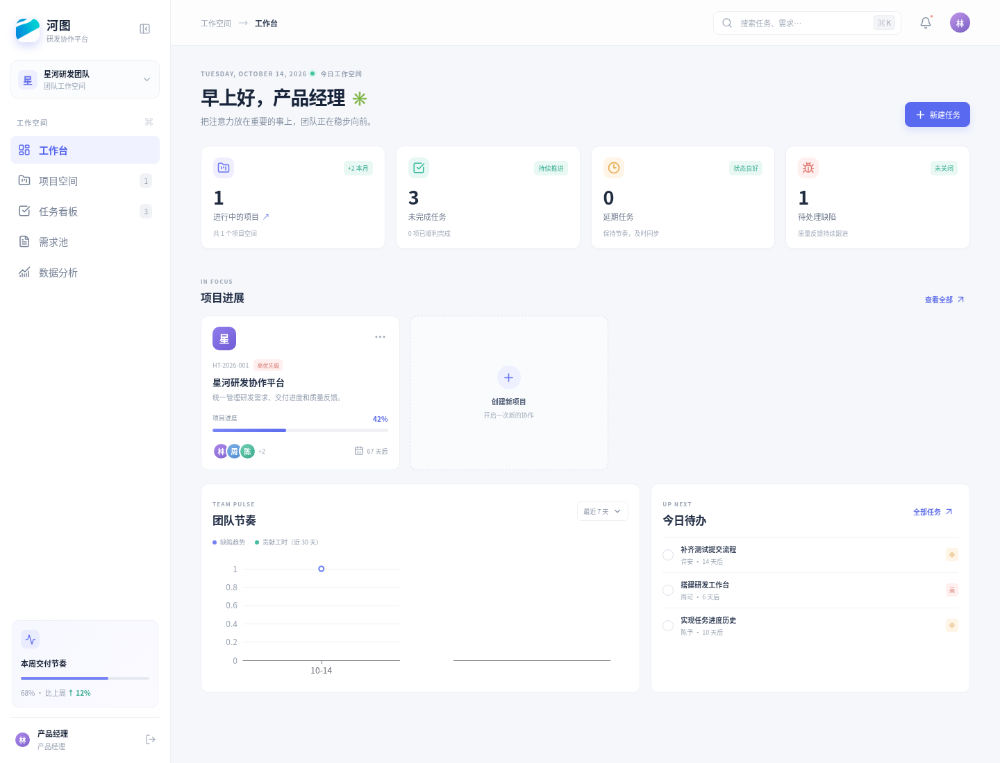
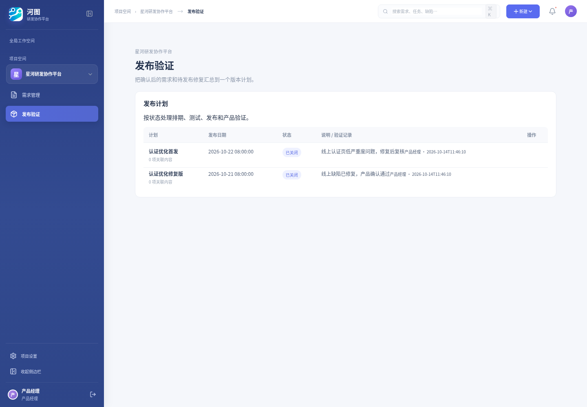

# 河图 Hetu

> **Beta 版**：当前版本用于流程验证和团队试用。项目、需求、任务、提测、缺陷闭环、角色权限、发布计划和基础统计已打通；评论、完整附件中心、管理端独立网页、通知和生产级部署仍在完善。演示账号共用弱口令，首次部署后请立即修改。数据模型或接口仍可能调整，不建议直接用于关键生产数据。

河图面向研发团队，目标是让“需求 → 任务 → 开发进度 → 提测 → 测试 → Bug → 修复验证 → 交付分析”形成可追踪闭环。后端以若依 RuoYi-Vue 3.9.2 为基础，业务接口独立在 `hetu-project` 模块；用户工作台使用 Vue 3、Element Plus 和 ECharts。

## 系统截图







## 两个入口

| 入口 | 本地地址 | 面向谁 | 当前能力 |
| --- | --- | --- | --- |
| 用户工作台 | `http://localhost:5173` | 产品经理、技术总监、开发、测试、运维及系统管理员 | 项目协作主界面；登录后按角色展示导航和允许的操作。所有业务角色使用这里登录。 |
| 管理/API 入口 | `http://localhost:8080/swagger-ui.html` | 系统管理员及开发运维 | 若依后端 API 文档与接口调试入口；用户、角色、菜单、权限等管理 API 仍在。**Beta 暂无独立的可视化若依系统管理前端**，Swagger 不是完整的管理后台。 |

系统管理员也从用户工作台登录；若依管理权限和河图业务角色由后端权限校验。前端隐藏无权入口，后端接口会再次检查权限。业务角色账号如下，初始密码均为 `admin123`，仅限本地演示：

| 账号 | 角色 | 主要职责 |
| --- | --- | --- |
| `admin` | 系统管理员 | 全部河图业务权限及若依管理权限 |
| `pm` | 产品经理 | 维护需求、提交线上缺陷、验证发布 |
| `director` | 技术总监 | 把需求拆分成开发任务并分派给成员 |
| `developer` | 开发人员 | 通用开发演示账号 |
| `frontend` / `backend` | 开发人员 | 前端与后端独立演示账号，用于双开发分派与缺陷扣分验证 |
| `tester` | 测试人员 | 查看测试任务、登记与复测缺陷、提交发布测试 |
| `ops` | 运维工程师 | 创建排期、执行发布、手动关闭发布计划 |

业务角色的主界面保持精简：产品经理维护需求并验证发布；技术总监分派开发任务；开发人员处理自己的任务、登记工时并在任务详情推进关联缺陷；测试人员处理测试任务和缺陷，发布测试提交位于测试页；运维工程师创建排期、发布和关闭版本。

若依用户管理、角色管理等后端接口没有删除，系统管理员可使用 Swagger 并以有对应若依权限的账号调用 `/system/user/list`、`POST/PUT /system/user`、`PUT /system/user/resetPwd` 和 `/system/user/changeStatus` 管理账号、角色、密码和启停状态。当前缺少传统若依 Vue 管理前端；因此浏览器里没有独立的用户/角色管理菜单。

## 本地启动

需要 Java 17+、Maven 3.9+、Node.js 20+ 和 MySQL 8。无需安装 Docker；可以直接使用本机已有的 MySQL 客户端和数据库，不启动 Redis。

1. 配置已有 MySQL 连接。环境变量为 `HETU_DB_URL`、`HETU_DB_USERNAME` 和 `HETU_DB_PASSWORD`。新建空库时先初始化若依基础表，再导入 `sql/hetu.sql`；已有河图数据库无需重导基础数据，应用启动时会自动补齐本次新增的字段和表。若需启用 Druid 监控页，再配置 `DRUID_STAT_ENABLED=true`、`DRUID_STAT_USERNAME` 和 `DRUID_STAT_PASSWORD`。

2. 构建并启动后端（本机单进程开发模式使用内存缓存）：

   ```sh
   mvn -DskipTests package
   java -jar ruoyi-admin/target/ruoyi-admin.jar --app.cache.in-memory=true
   ```

   API 在 `http://localhost:8080`。Swagger 文档在 `http://localhost:8080/swagger-ui.html`。

3. 启动用户工作台：

   ```sh
   cd hetu-ui
   npm ci
   npm run dev
   ```

   打开 `http://localhost:5173`。前端会把 `/api` 请求代理到 Spring Boot；本地演示数据库默认关闭验证码以便试用；部署到共享或生产环境前请在若依系统参数中重新开启。

内存缓存用于单机开发，令牌、验证码和缓存数据会在应用重启后丢失。业务字段升级也可用 MySQL 客户端手动执行 [`sql/hetu_core_capabilities.sql`](sql/hetu_core_capabilities.sql)。

## 当前功能

- **工作台与分析**：项目、待办、延期、缺陷指标；项目进度、缺陷趋势和人员贡献图表。
- **项目**：编号、负责人、日期、状态、优先级、描述和汇总进度。
- **需求**：Markdown 编辑和预览，支持标题、表格、代码块、列表；已保存需求正文支持粘贴 PNG、JPEG、GIF、WebP 截图。
- **任务**：看板/列表、负责人、预计工时、百分比进度、优先级、截止日期；状态包含待处理、进行中、待测试和已完成。
- **进度核算**：只填写累计完成百分比。后端阻止进度回退，并按“预计工时 × 本次完成比例增量”记录贡献工时；进度到 100% 后自动进入待测试。
- **测试流程**：任务达到 100% 后自动进入待测试；测试人员可以通过并关闭任务，也可以退回开发。开发修复后重新提测，再由测试人员复测通过。
- **任务池**：创建任务时可不指定开发人员，开发人员可自行领取；测试人员可接收进入待测试的任务，并通过或退回。
- **工时排名**：进度按工作日期记录；支持按自选日期范围查看个人贡献工时、提交明细和排名。
- **缺陷闭环**：登记类型、等级、描述、复现步骤、责任人和归因；状态为新建、处理中、待验证、关闭。关闭时后端按缺陷归因计算并保存工时扣减。
- **质量负面清单**：关闭缺陷自动记录责任人和扣减工时；项目管理者可登记日常事项并查询个人记录。
- **发布计划**：建立版本计划，将已确认需求和已关闭缺陷加入发布范围。
- **权限**：若依认证、菜单权限和接口权限；产品经理、技术总监、开发、测试、运维按职责分权。产品经理维护需求、提交线上问题并验收发布；技术总监拆分分派任务；开发处理自己的任务和修复；测试负责测试、缺陷复测和版本提测；运维创建排期、发布和手动关闭版本。

### 默认缺陷工时扣减策略

缺陷完成修复验证并关闭后，按归因计算责任人对应的扣减工时；未关闭缺陷显示“待判定”。同一缺陷更新时按当前任务预估工时、等级和归因重新计算，不重复累加。

**开发类问题**（归因“开发类问题”）按关联开发任务的预估工时比例扣减，关闭时必须关联有效任务：

| 严重度 | 扣减比例 | 10 小时任务示例 |
| --- | ---: | ---: |
| 致命（CRITICAL） | 50% | 5 小时 |
| 严重（HIGH） | 30% | 3 小时 |
| 一般（MEDIUM） | 10% | 1 小时 |
| 轻微（LOW） | 5% | 0.5 小时 |

**非开发类问题**按严重度直接扣固定工时：致命 5 小时、严重 3 小时、一般 1 小时、轻微 0 小时。该规则用于需求变更和环境/第三方问题；重复问题与无法复现不扣工时。后端将结果保存为 `score_hours`（负数表示扣减），忽略客户端传入的计算值。现有历史缺陷不追溯扣减。

## 数据库和接口

`sql/hetu.sql` 创建项目、需求、任务、进度历史、缺陷、版本、评论、附件元数据和操作日志表；并初始化河图菜单、五个业务角色及演示账号。所有业务数据持久化在 MySQL，表使用 `utf8mb4`。上传图片放在若依配置的数据目录下。

主要业务 API 位于 `/hetu`，以若依 token 认证并由 `@ss.hasPermi` 校验权限：

| 方法 | 路径 | 用途 |
| --- | --- | --- |
| GET | `/hetu/dashboard` | 工作台和分析汇总 |
| GET / POST / PUT | `/hetu/projects` | 项目查询、创建和更新 |
| GET / POST / PUT | `/hetu/requirements` | 需求查询、创建和更新 |
| GET / POST / PUT | `/hetu/tasks` | 任务查询、创建和更新 |
| PATCH | `/hetu/tasks/{id}/progress` | 更新累计进度并记录贡献 |
| PATCH | `/hetu/tasks/{id}/status` | 推进测试和任务状态 |
| GET / POST / PUT | `/hetu/bugs` | 缺陷闭环和关闭计分 |
| POST | `/hetu/attachments` | 上传关联图片 |

## 验证

```sh
npm --prefix hetu-ui ci
npm --prefix hetu-ui run build
mvn -DskipTests package
```

端到端测试脚本会创建真实需求、前后端任务、工时记录、测试退回与通过、各严重度的扣分和免扣分缺陷，以及两轮版本发布和产品验收。它需要一个已经初始化河图 SQL、关闭登录验证码的**一次性测试数据库**，且初始演示账号密码均为 `admin123`：

```sh
python3 scripts/e2e_workflow.py http://localhost:8080
```

脚本会留下测试数据，请勿对开发、演示或生产数据库执行。当前验证覆盖开发类缺陷 50%/30%/10%/5%、需求变更和环境问题固定扣 5/3/1/0 小时，以及 `NO_DEDUCTION`、重复问题和无法复现三类免扣分分支；发布流程覆盖测试通过、运维发布、产品待完善、修复后二次发布、原产品经理验收和手动关闭。

本项目仍处于 Beta；发布前应在目标部署环境验证初始化 SQL、账号口令、数据库备份恢复、角色权限和缺陷计分规则，并替换演示密钥及密码。
